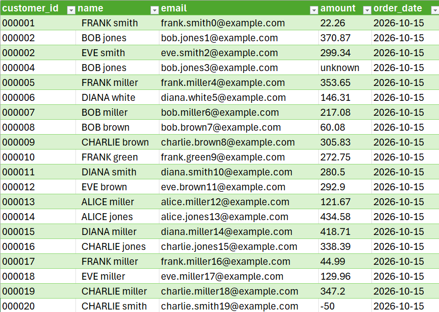
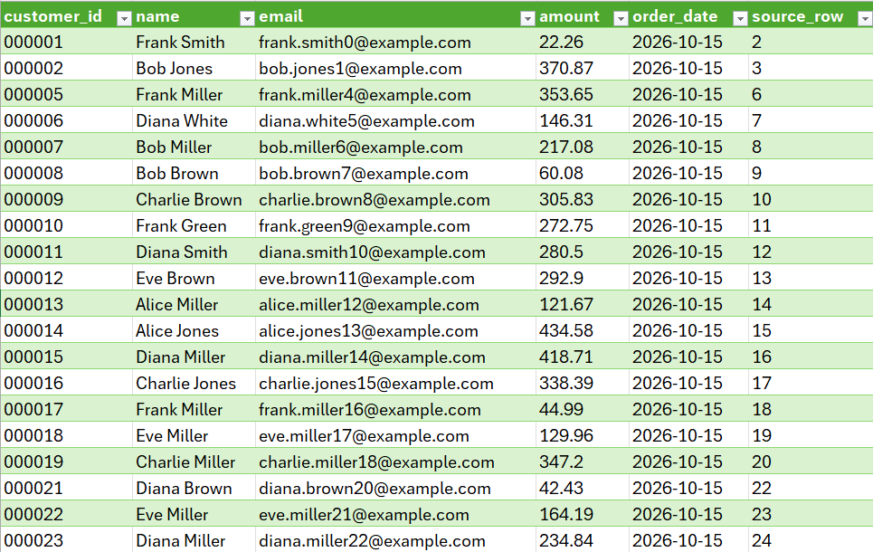
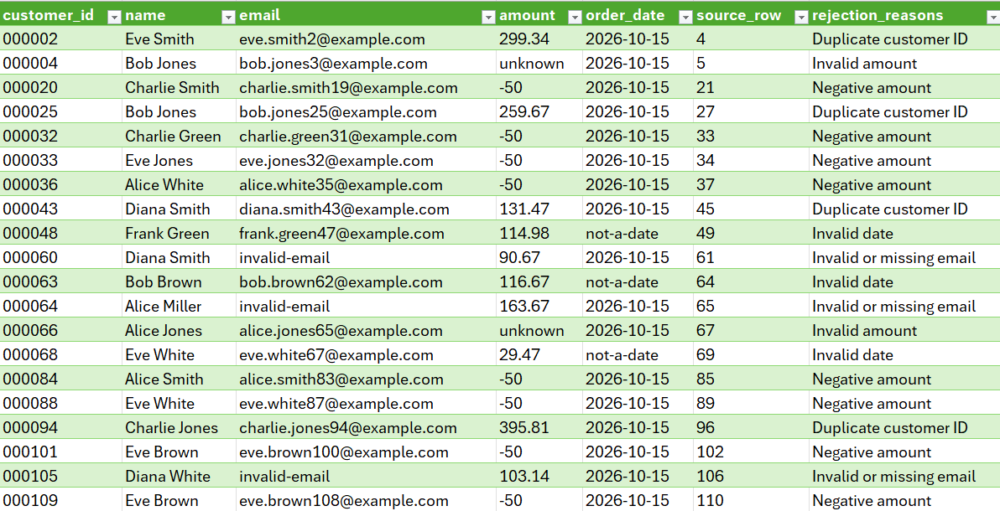

# Case Study 1 — Customer Data Cleaning and Validation

**Project:** DataClean Pro  
**Service category:** Excel/CSV cleaning and data validation  
**Demonstration type:** Synthetic dataset, not a paid client project

## Business problem

Customer exports frequently contain inconsistent text formatting, duplicate identifiers, invalid monetary values, malformed email addresses, and invalid dates.

These inconsistencies can compromise downstream reporting and require manual investigation.

The objective of this demonstration is to identify problematic records, normalize supported fields, and create auditable outputs while preserving flagged data for review.

## Solution

DataClean Pro implements a repeatable data-processing workflow:

1. Import the original CSV dataset without overwriting it.
2. Normalize column names and supported text fields.
3. Apply documented data-validation rules.
4. Separate accepted records from records requiring review.
5. Preserve rejection reasons.
6. Export the resulting datasets and a JSON quality report.

## Demonstration results

| Metric | Value |
|---|---:|
| Synthetic input records | 1,000 |
| Accepted records | 871 |
| Flagged records | 129 |
| Acceptance rate | 87.1% |
| Flagged rate | 12.9% |

**Reconciliation:** 1,000 input records = 871 accepted + 129 flagged.

The flagged records were retained rather than silently discarded.

## Deliverables

- `input_sample.csv` — original synthetic dataset
- `cleaned_customers.csv` — accepted records
- `flagged_rows.csv` — rejected records with reasons
- `quality_report.json` — processing statistics

## Verification

The results are reproducible using the documented DataClean Pro command-line workflow.

The project's automated test suite additionally checks supported cleaning and validation behavior.

[View source repository](https://github.com/Monad65537/freelancing-data-toolkit)

## Limitations

- Email checks validate syntax, not mailbox existence.
- Name capitalization uses simple text rules.
- Missing customer names are not automatically rejected.
- Duplicate-ID handling follows a demonstration-specific uniqueness assumption.
- Leading zeros already lost in an upstream application cannot be reconstructed.
- Large-scale production performance remains unverified.

## Conclusion

This synthetic demonstration illustrates reliable, repeatable cleaning and validation of customer records, including explicit identification of records requiring manual review.

It does not represent a completed paid client engagement.

## Visual Demonstration

### Original Customer Dataset

### Accepted Customer Records

### Flagged Records

