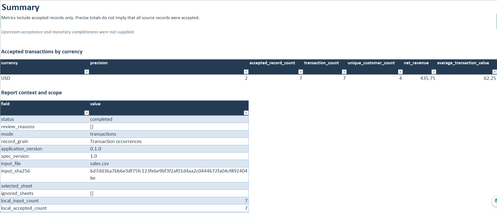
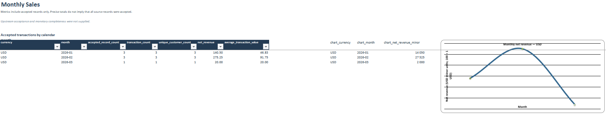
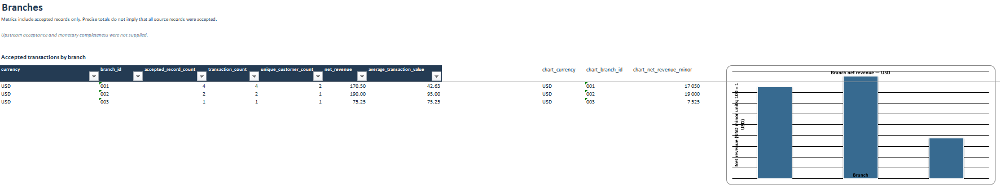
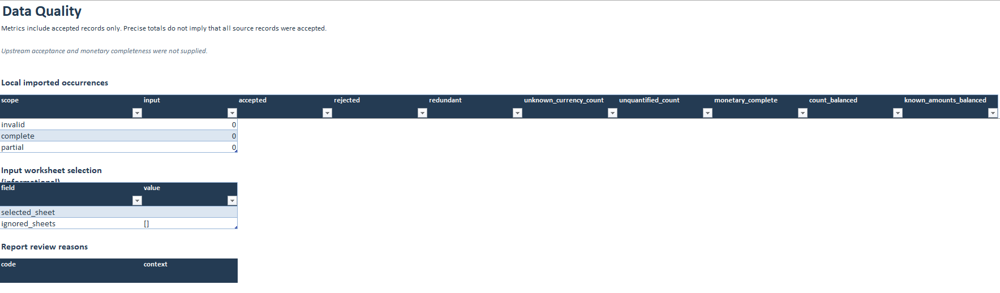

# Case Study 2 — Automated Sales Reporting

**Project:** SalesReport Auto 0.1.0  
**Service category:** Spreadsheet reporting and business automation  
**Demonstration type:** Synthetic sales transactions

## Business problem

Businesses often need to transform raw sales exports into structured reports showing revenue, monthly trends, and branch-level performance.

Repeated manual reporting creates opportunities for inconsistent calculations, transcription mistakes, and undocumented data exclusions.

## Solution

SalesReport Auto processes compatible sales datasets through a documented pipeline that:

1. Imports and validates transactions.
2. Classifies accepted, rejected, and redundant records.
3. Calculates exact monetary aggregates.
4. Groups results by relevant business dimensions.
5. Generates a structured Excel workbook.
6. Preserves data-quality information and source records for review.

## Demonstration results

| Metric | Result |
|---|---:|
| Accepted transactions | 7 |
| Net revenue | USD 435.75 |
| Report status | Completed |
| Execution exit code | 0 |
| Output format | XLSX |

## Report contents

The generated workbook contains five worksheets:

| Worksheet | Contents |
|---|---|
| Summary | Financial metrics and reporting status |
| Monthly Sales | Monthly aggregates and revenue charts |
| Branches | Branch-level business metrics |
| Data Quality | Validation results and monetary coverage |
| Raw Data | Original input records and classifications |

## Deliverables

- `input_sample.csv` — synthetic source transactions
- `sales_report.xlsx` — generated Excel report

## Verification

The report was generated using the project's documented command-line interface.

The project also has automated tests covering validation, financial precision, aggregation, workbook generation, and output integrity.

[View source repository](https://github.com/Monad65537/salesreport-auto)

## Limitations

- Inputs must follow supported schemas.
- The program cannot detect sales missing from the original export.
- Currency conversion is not supported.
- Tax, discount, and refund-accounting policies are not inferred.
- The project is a portfolio release candidate, not independently production-certified.

## Conclusion

This synthetic demonstration illustrates how structured sales exports can be transformed into reproducible Excel reports containing financial summaries, charts, and data-quality evidence.

It does not represent a completed paid client engagement.

## Visual Demonstration

### Sales Summary

### Monthly Sales

### Branch Performance

### Data Quality

